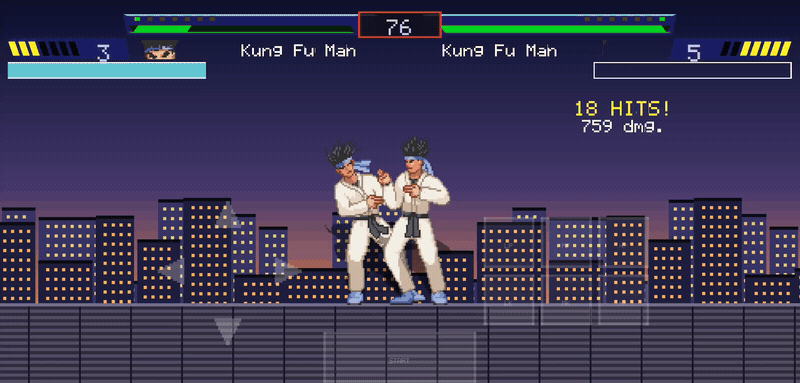
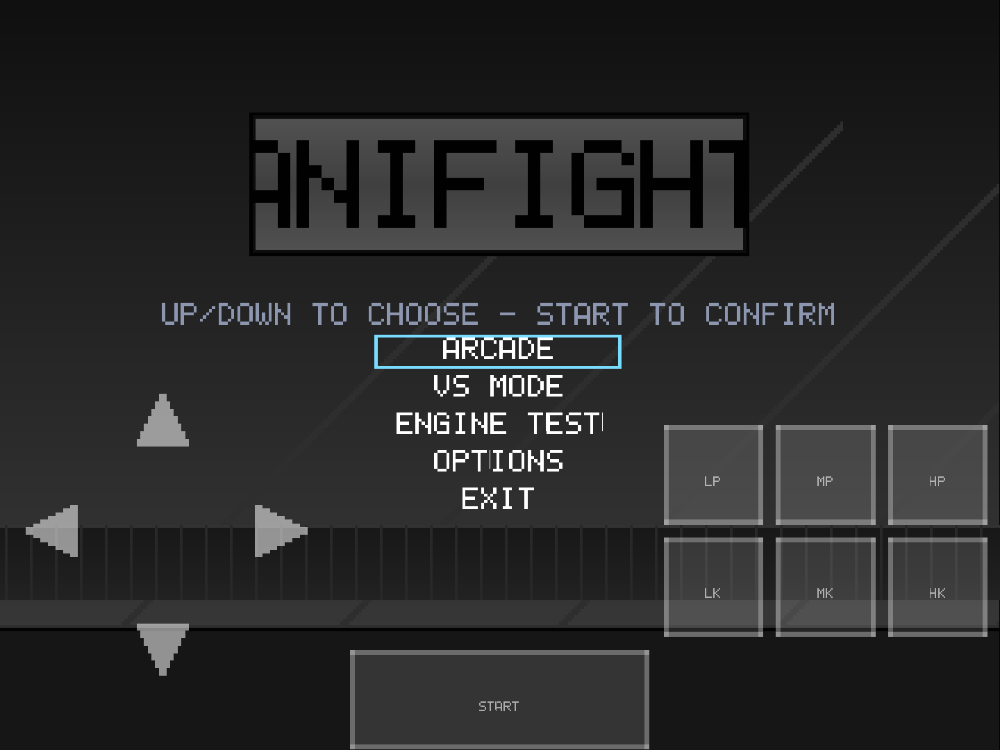
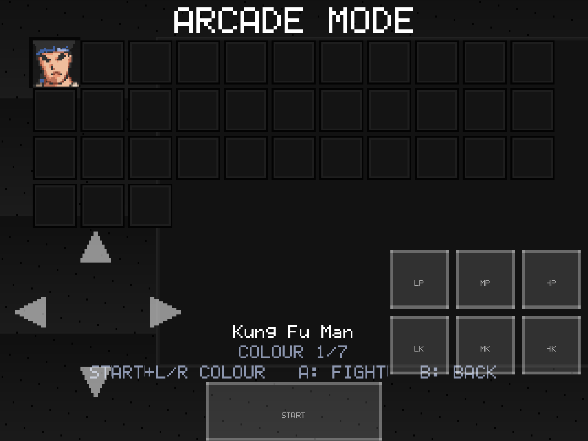
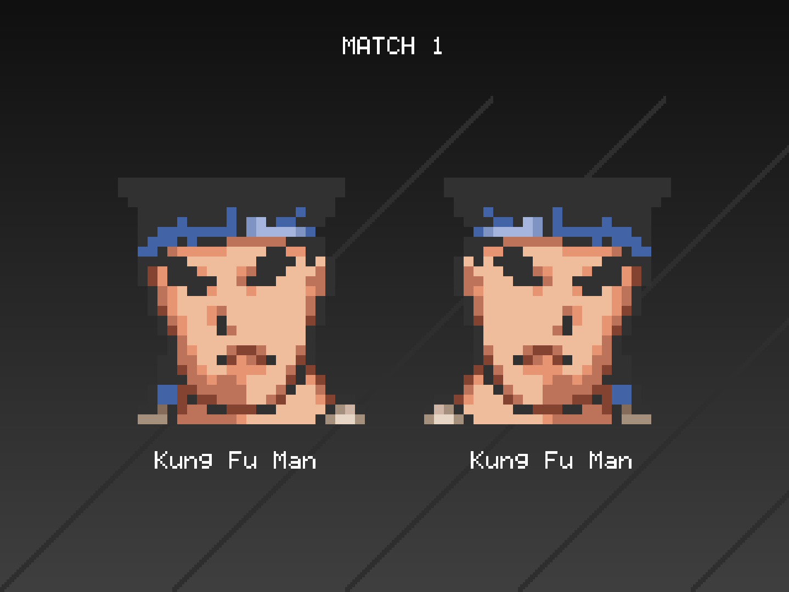
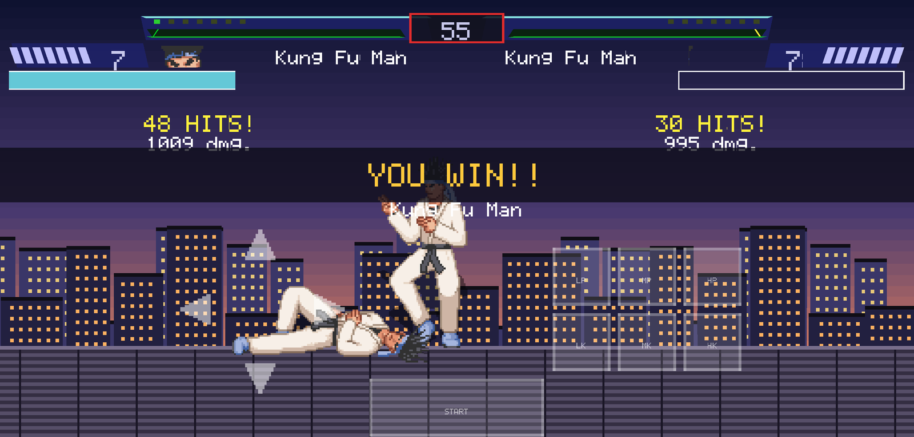
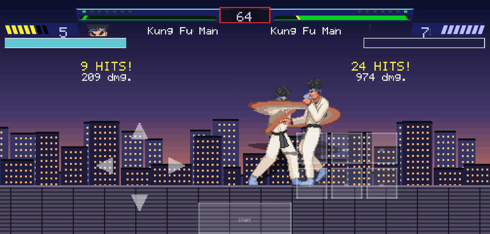

<div align="center">
  
  <h1>anifight</h1>
  <p><strong>A MUGEN-compatible 2D fighting game engine for Android, written from scratch in C++20.</strong></p>
  <p>Native GLES rendering · 60 Hz fixed-step fight core · no third-party runtime dependencies</p>

  [](#building)
  [](#architecture)
  [](#mugen-compatibility)
  [](LICENSE)
</div>

<br>

<div align="center">
  
  <br>
  <sub>Arcade fight captured on a phone. Both fighters are <strong>Kung Fu Man</strong>, the engine's reference character — no third-party character art ships with this repository.</sub>
</div>

<br>

**anifight** is an Android game engine that reads MUGEN 1.0 data directly: characters,
screenpacks, stages, fonts, palettes and sound banks. It interprets a character's own
`.cns` states and `.cmd` commands, so fighters use their scripted specials and supers
rather than a built-in move list.

It is not a MUGEN port and not a wrapper around another engine. The SFF/AIR/SND codecs,
the expression evaluator, the command matcher, the state machine, the collision and hit
resolution, and the renderer are all implemented in this repository.

## Contents

- [Modes](#modes)
- [Screenshots](#screenshots)
- [MUGEN compatibility](#mugen-compatibility)
- [Controls](#controls)
- [The roster](#the-roster)
- [Building](#building)
- [Tests](#tests)
- [Architecture](#architecture)
- [Documentation](#documentation)
- [Credits](#credits)
- [License](#license)

## Modes

| Mode | What it does |
|---|---|
| **ARCADE** | Pick a fighter and climb an eight-match ladder. Each match is best-of-three, and `select.def`'s `arcade.maxmatches` decides how many fights sit at each difficulty tier. |
| **VS MODE** | Two picks on one device. Player two gets the same touch pad. |
| **ENGINE TEST** | A roster-less fight with placeholder fighters, for checking the screenpack, HUD and lifebars. |
| **OPTIONS** | Reposition and rescale the on-screen controls; the layout is stored in `anifight.ini`. |

The game boots straight into the title menu and runs the fight at a fixed 60 Hz, with
rendering decoupled from the simulation.

## Screenshots

<div align="center">

<table>
  <tr>
    <td align="center"><br><sub>Title menu</sub></td>
    <td align="center"><br><sub>Character select</sub></td>
  </tr>
  <tr>
    <td align="center"><br><sub>Match card</sub></td>
    <td align="center"><br><sub>Knockout</sub></td>
  </tr>
</table>


<br>
<sub>Hit detection, corner push, juggle limits and the combo counter, mid-match.</sub>

</div>

> The character grid reserves a cell for every community character named in
> `tools/screenpack/data/select.def`. Empty cells are slots whose character folder is not
> installed — no character art is bundled, and the cursor steps over them cleanly.

## MUGEN compatibility

The engine reads the formats and runs the fight rules that real MUGEN characters depend on:

**Files** — SFF v1 and v2 sprites (including RLE5 and PNG), AIR animations with
collision boxes and interpolation, SND/WAV banks, ACT palettes, and the full `.def`
family: `fight.def` lifebars, `select.def`, `mugen.cfg`, stages, storyboards and victory
quotes.

**Fight core** — HitDef attributes, hit flags and fall parameters; clsn collision;
juggle limits; guard, chip damage and guard clocks; hitpause; corner push; priority
clashes; projectiles with hit/guard/contact timing; explods; helpers with the full
parent/root entity graph; targets and `TargetBind`/`TargetFacing`; `p2getp1state` throws;
`PalFX`/`BGPalFX`/`AllPalFX`; `RemapPal`; and the `GetHitVar` animtype/type cascade that
characters branch on.

**Scripting** — MUGEN expressions and triggers, `var`/`fvar`/`sysvar` and `:=`, the CMD
matcher (including `>` and `$` command modifiers), state controllers, the state machine,
and per-character audio parameters.

**Presentation** — screenpack motif, animated backgrounds, fonts, lifebars, the select
grid and stage list, storyboard playback, round flow, continue prompts and arcade
endings.

Known gaps are tracked honestly in [`docs/mugen-re/PARITY-ROADMAP.md`](docs/mugen-re/PARITY-ROADMAP.md):
team modes, a real AI script, stage zoom and floor reflections are not implemented yet.

## Controls

The touch pad is laid out like a handheld: a d-pad on the left, six attack buttons on the
right, and a Start bar at the bottom.

| Input | Action |
|---|---|
| D-pad | Stand, walk, crouch, jump |
| `LP` `MP` `HP` | Light / medium / heavy punch |
| `LK` `MK` `HK` | Light / medium / heavy kick |
| `START` | Confirm in menus; abandon a match |
| `B` (or `MK`) | Back out of a screen or an unfinished pick |

On the select screen, hold `START` and press left or right to cycle a character's
palette. Only characters with alternate palettes offer the chord.

The pad can be moved, scaled and faded from **OPTIONS**; its placement is saved to
`anifight.ini` in the app's private storage.

## The roster

**No character ships with this game.** Kung Fu Man is the engine's reference character
and the only fighter the stock build can show; the rest of the grid is reserved for
community characters and fills in when you provide them.

Put a character folder in `local_chars/` under the name `select.def` expects:

```
local_chars/goku/goku.def   ->   APK assets: mugen/chars/goku/   ->   one select-grid cell
```

`local_chars/` is gitignored, and Gradle's `assembleLocalChars` task copies it into the
APK at build time. Nothing enters the source tree, and nothing third-party is
redistributed. See [`docs/COMMUNITY.md`](docs/COMMUNITY.md) for the full policy and the
reserved roster.

## Building

**Requirements** — JDK 17, Android SDK with API 36, NDK `27.1.12297006`, CMake `3.22.1`,
and Python 3 for the asset generators. The app targets `arm64-v8a` and Android 7.0
(API 24) or newer.

```sh
# Debug APK
./gradlew :app:assembleDebug

# Build and install on a connected device
./gradlew :app:installDebug
```

The MUGEN data folder is assembled at build time. Hand-written `.def`/`.cfg` files live in
`tools/screenpack/data/`; the binary sprites, fonts, stages and sounds are generated by
`tools/screenpack/gen.py` and `tools/stages/gen.py`, which draw the project's own art and
write real MUGEN files. The generators are written against the published format specs,
independently of the C++ loaders.

With a large `local_chars/` collection, a slim dev build packages only the characters you
name:

```sh
./gradlew -Panifight.devChars=kfm :app:installDebug
```

## Tests

The host test suite runs without Gradle, CMake or a device:

```sh
./tools/hosttest/run_all_tests.sh
```

It covers the codecs, the expression and command matchers, the state machine, the
screenpack reader and the palette pipeline. Tests that need copyrighted fixtures (a KFM
sprite bank, real sound banks, a character folder) are skipped with a note when those
files are absent; point them at your own with `ANIFIGHT_KFM_SFF`, `ANIFIGHT_SND` and
`ANIFIGHT_CHARACTER`.

## Architecture

```
app/src/main/cpp/
  core/       logging, INI reading, file sources
  gfx/        GLES renderer, textures, fonts, sprite banks, SFF/PCX codecs
  audio/      mixer and SND/WAV playback
  platform/   Android asset and audio output glue
  jni/        the native entry points
  engine/
    defs.*          DEF family, stages, screenpack and motif
    anim.*          AIR animations and collision boxes
    expr.*          expression parser and evaluator
    cmd.*           command matcher
    cns.*           state-controller parser
    statemachine.*  per-character state execution
    character.*     character loading, palettes, sounds
    entities.*      helpers, explods, projectiles, targets
    fighter.*       hit resolution, guard, juggle, power
    storyboard.*    arcade endings and intro scenes
    screens/        title, select, stage select, fight,
                    versus, victory, continue, storyboard
```

The simulation is a fixed 60 Hz tick. Screens are a stack owned by the engine; a fight
pushes a victory card and pops back to the ladder, and the title screen survives beneath
the whole arcade run. Assets are read directly from the APK without decompression, which
keeps loading fast on mid-range phones.

## Documentation

- [`docs/COMMUNITY.md`](docs/COMMUNITY.md) — roster policy, character setup, art-scale rules.
- [`docs/mugen-re/PARITY-ROADMAP.md`](docs/mugen-re/PARITY-ROADMAP.md) — what is implemented, what is not, and why.
- [`docs/mugen-re/FINDINGS.md`](docs/mugen-re/FINDINGS.md) — reverse-engineering notes from the reference implementation.
- [`docs/mugen-re/GAMEPLAY-PARITY-COMPARISON.md`](docs/mugen-re/GAMEPLAY-PARITY-COMPARISON.md) — side-by-side behaviour comparison.

## Credits

- **Kung Fu Man** — © 2009 Elecbyte. The engine's reference character and the first real
  SFF v2 file it parsed. Its files are not redistributed here; the screenshots and GIF
  above were captured from a local build using the copy supplied with MUGEN.
- **Community characters** keep their credit in their own `.def` files, where their
  authors put it.
- **The screenpack, stages, fonts and effects** are the project's own art, generated by
  the scripts in `tools/`.
- Created in [T3 Code](https://t3.codes).

## License

[MIT](LICENSE) © 2026 Utkarsh Deoli.

MUGEN is a trademark of Elecbyte. This project is not affiliated with or endorsed by
Elecbyte. Character and stage files remain the property of their respective authors.
